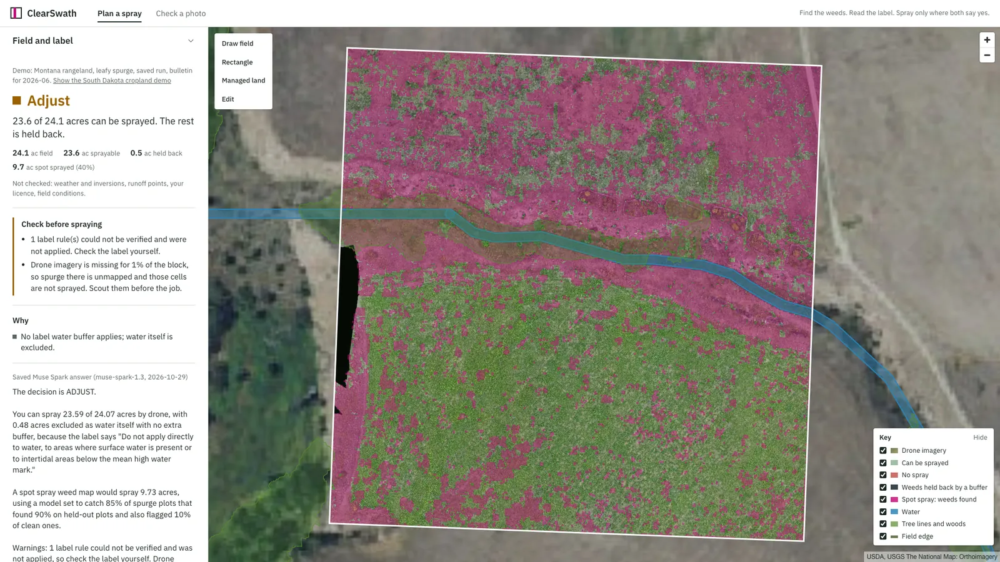
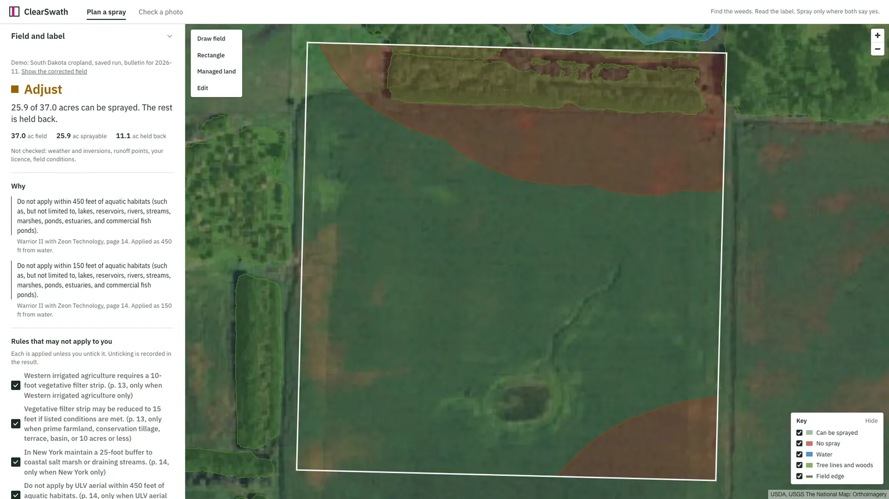
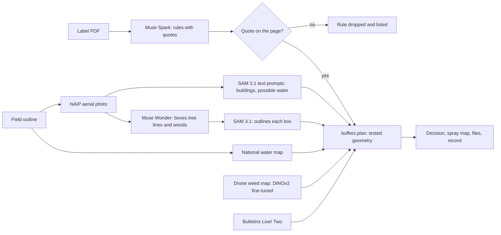

# ClearSwath

**Find the weeds. Read the label. Spray only where both say yes.**

A pesticide label is a legal document of 20 to 70 pages: setbacks from water, wind limits, rates, endangered-species
bulletins. A drone can now spray single patches of weeds, but nothing reads the label for it. ClearSwath does. Give it
a field, the label PDF and a drone weed map. It returns:

- **a decision** (No conflicts in checked rules, Adjust, or Do not spray), each reason with the label sentence it
  comes from, quoted word for word and checked against the PDF;
- **a spray map**: 1 m cells sprayed only where the weed map found weeds and no label rule, water body or
  endangered-species bulletin says no;
- **files for the sprayer**: a DJI Agras prescription (boundary shapefile plus a rate GeoTIFF), GeoJSON and KML;
- **a draft application record**, filled from the applicator's spoken or typed notes.

Built for the Meta Global AI Developer Hackathon (Indie Developer track, "Build for Your World"), October 26 to
November 4, 2026, by someone from a South Dakota farm family: the problem of turning a label into lines on a field is
one I know firsthand.



## Try it

Press **Try the demo**. The demo replays saved real runs, so it is free and instant.

- **Montana rangeland, leafy spurge.** A 24-acre block of a real drone orthomosaic (MPG Ranch, 1.27 cm per
  pixel), sprayed with Tordon 22K. A stream crosses the block; Muse Wonder and SAM 3.1 outline the trees along it.
  Result: **Adjust**; 23.6 of 24.1 acres may be sprayed, and the weed map sprays 9.7 of them. Tick "Ask Muse Spark to
  explain the plan" to see Muse Spark 1.3's saved answer, with each tool it called.
- **South Dakota cropland**, linked from the Montana result. A field drawn up to a creek, sprayed with Warrior II.
  The 150 ft aerial buffer takes a strip along the creek (Adjust), and the corrected outline is clear (No conflicts in
  checked rules). Untick the ULV rule on the way: rules that only apply in some cases are applied until you say
  they don't.



Live runs on your own field and label need an access code: 3 per address per day, within a $5 daily model budget.

Run it yourself (Python 3.12, [uv](https://docs.astral.sh/uv/), Node 22):

```sh
uv sync
cd web-app && npm ci && npm run build && cd ..   # the page, built into web/dist
cp .env.example .env        # add MODEL_API_KEY (Meta Model API); BASETEN_API_KEY for Muse Spark Open
uv run uvicorn app.api:app  # then open http://localhost:8000
uv run pytest               # no test calls the network or a model
```

## How it decides

1. **Field.** Drawn on the map or uploaded as GeoJSON. Water comes from the National Hydrography Dataset. On the
   NAIP aerial photo, Muse Wonder draws a box around each tree line and wood and SAM 3.1 outlines what is in the box;
   SAM's own text prompts find buildings and open water. Water only the photo shows is "possible water": it never
   changes the map, but the plan can't be a clean pass until someone checks it.
2. **Label.** Muse Spark reads every page into a strict schema (setbacks, wind, rain, rates, runoff points), each rule
   with a word-for-word quote. Code drops any rule whose quote is not on the page it claims.
3. **Bulletin.** EPA's Bulletins Live! Two is checked for the product, place and month.
4. **Weeds.** A drone weed map from a trained head on Meta's DINOv2 / DINOv3 image features.
5. **Plan.** Pure geometry in the field's UTM zone. Label setbacks buffer their hazards, water itself is never
   sprayed, a bulletin ban or any missing data means Do not spray, and a label that requires runoff mitigation
   points is Adjust (complete them in EPA's PALM). A cell touching any buffer is held back, which always beats spray.
6. **Export and record.** Prescription files for the sprayed cells, and the record with every missing field flagged.



**No model makes the decision.** Status, buffers and rates come from tested code (`app/buffers.py`, `app/cells.py`).
If the Muse Spark agent's answer names a different status, calls the plan "legal", "compliant" or "safe", or quotes text
that is not on the label, the answer is replaced with the plan's own summary.

## Meta models

| Model | Where | Its job | How its output is checked |
|---|---|---|---|
| Muse Spark 1.3 | Meta Model API | Reads the label into rules; explains the plan as an agent with four tools | Every quote matched to the label text; the decision always from code |
| Muse Spark Open | Baseten (Fireworks as failover) | The same jobs on open weights | Same checks; an empty read is asked again, never cached |
| Muse Wonder 1.0 | Meta Model API | Looks at the aerial photo and boxes every tree line and wood for SAM | Scored against ESA WorldCover on 20 tiles (below) |
| SAM 3.1 | Meta Model API, and open weights on Modal | Outlines Wonder's boxes; finds buildings and open water from text; zero-shot weed baseline | Scored against WorldCover and Microsoft building footprints |
| DINOv3 ViT-S/16 | Open weights, Modal GPU | Features for the crop-vs-weed head (CoFly, PhenoBench) | Cross-validated against pixel masks |
| DINOv2 ViT-B/14 | Open weights, fine-tuned on Modal | The leafy spurge model behind the Montana map | Scored on survey plots it never trained on |
| Muse Voice Transcribe 1.0 | Meta Model API | Turns a spoken job note into the record | Plan values always beat what the model heard; gaps listed |

## Hazard results

On 20 NAIP tiles around the demo fields, against ground truth no Meta model made (ESA WorldCover 2021 for trees,
shrubs and water; Microsoft building footprints). Full tables in `evals/results_scout.md`.

| What | SAM 3.1 text prompts alone | With Muse Wonder's boxes |
|---|---|---|
| Trees and shrubs found, mean per tile | 17% (median tile: 0%) | **62%** |
| Buildings found | 27 of 35 | (text prompts kept for buildings) |
| Water: precision | 95% | (text prompts kept for water) |

SAM 3.1 can't find a shelterbelt from the air by name, but outlines one closely from a box. Wonder supplies the boxes.
Wonder's results vary between runs on a single tile, and the truth is 10 m data from 2021, so these are rough numbers.

## Weed results

All numbers are on images the model never trained on. "Hit" is the share of weed pixels inside sprayed cells;
"sprayed" is the share of the area sprayed. Full tables are in `evals/`.

| Dataset | Method | Hit / sprayed |
|---|---|---|
| CoFly-WeedDB (cotton, 201 images, 5-fold) | DINOv3 head | **95.9% / 37.9%** at 0.25 m cells |
| | SAM 3.1, prompt "weed" (zero-shot) | 0% |
| PhenoBench (sugar beet, 3 flight dates) | DINOv3 head + 50 labelled tiles from the date sprayed | **95.5 to 97.9% / 15 to 18%** at 0.1 m |
| | Spray everything green | 83 to 98% / 19 to 59% |
| | SAM 3 open weights, "weed" (zero-shot) | 73% / 22% |
| Leafy spurge (Montana, 900 survey plots, 9 spatial clusters) | DINOv2-B, last 2 blocks fine-tuned | AUC 0.95 on clusters it never saw (frozen features: 0.88) |

On the Montana block the spurge model is tuned to catch 85% of the spurge plots in the clusters it trained on. On
the four clusters inside the block, which it never saw, it found 90% of spurge plots and flagged 10% of clean ones,
and it sprays 40% of the block (1 m cells). Catching more costs more: tuned to 90%, it finds 94% and sprays 68%.
The app states the catch rate next to the map. Frozen DINOv2 features alone sprayed 68% to find 81%.

Muse Spark Open was also tried as a reviewer of the photo mode's weed patches. On CoFly it called real weeds bare
soil and agreed with the ground truth only 52% of the time, so it is not in the app (`evals/results_patch_review.md`).

## Limits

- **Decision support, not clearance.** The plan checks the rules listed above. It does not check weather and
  inversions, compute runoff points, apply buffer reductions, or know the applicator's licence. The applicator
  follows the label and the official bulletin.
- **Montana and South Dakota only.** The record follows Montana's ARM 4.10.207 for commercial applicators.
- **The DJI prescription is not flight-tested.** Its folder layout follows PIX4Dfields' DJI export; check it on a
  controller first. The GeoJSON and KML work with any controller or GIS.
- **Drone spraying also needs** an FAA Part 137 certificate and a state aerial applicator licence.
- The answer keys for the label eval are not yet independently reviewed, so no label-reading accuracy is claimed here.

## Data and credits

- Leafy Spurge Dataset, MPG Ranch (Doherty et al.), CC BY 4.0, doi:10.57967/hf/2508: the Montana imagery and survey
  plots. Details in `data/demo/mt/SOURCE.md`.
- CoFly-WeedDB, CC BY 4.0. PhenoBench, CC BY-SA 4.0 (www.phenobench.org).
- National Hydrography Dataset, The National Map and NAIP imagery (public domain). EPA Bulletins Live! Two and EPA
  product labels.
- ESA WorldCover 2021 (CC BY 4.0) and Microsoft Global ML Building Footprints (ODbL), for the hazard eval only.
- The page is built on Meta's Astryx design system with StyleX. MapLibre GL JS (BSD-3-Clause); React, react-map-gl,
  Terra Draw, Astryx and StyleX (MIT); IBM Plex (SIL Open Font License).

## Repository

`app/` the service (FastAPI); `web-app/` the page (React, built into `web/dist`); `train/` Modal GPU jobs for the weed models; `evals/`
results and answer keys; `scripts/` demo builders and the label eval; `docs/CONTRACTS.md` module contracts.
